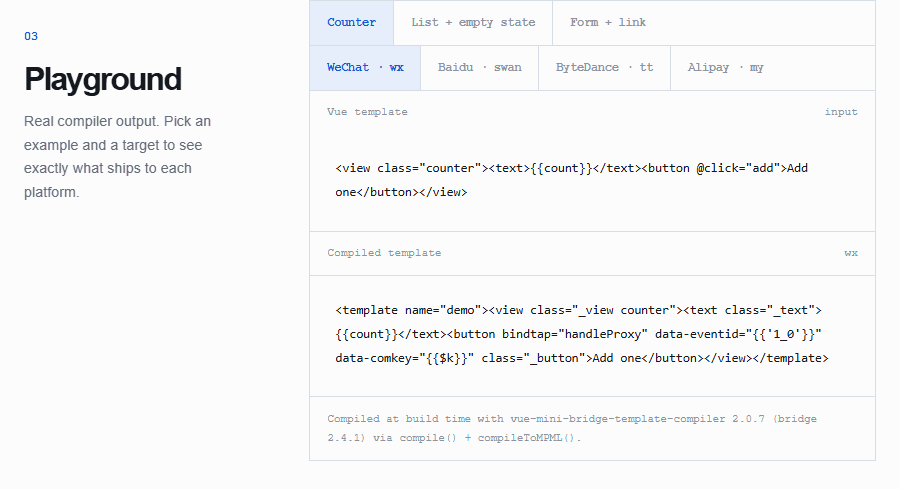

# Vue Mini Bridge

[](https://github.com/Archerkattri/vue-mini-bridge/actions/workflows/ci.yml)
[](https://www.npmjs.com/package/vue-mini-bridge)
[](LICENSE)

Vue Mini Bridge is a Vue 2 runtime and template compiler for mini-program projects. It continues the [mpvue](https://github.com/Meituan-Dianping/mpvue) codebase with an English-maintained source tree and updated build tooling.



## Status

This project is derived from Vue 2.4.1-era mpvue and remains a Vue 2 project. It is not a Vue 3 compatibility layer. Vue 2 reached end of life on December 31, 2023; see the [Vue 2 end-of-life notice](https://v2.vuejs.org/eol/).

The source includes adapters for WeChat (`wx`), Baidu (`swan`), ByteDance (`tt`), and Alipay (`my`). Their behavior varies by platform and developer-tool version. The project’s automated tests cover the compiler and runtime adapters; validate your application in each target vendor’s current tools before release.

The package manifests prepare version `2.0.9`, which remains unreleased until published. See the [changelog](CHANGELOG.md) for changes in that candidate; the npm badge shows the latest published version.

## Packages

- `vue-mini-bridge` provides the mini-program runtime.
- `vue-mini-bridge-template-compiler` compiles Vue templates into platform markup for use with a compatible loader.

The packages are built from this repository. Runtime changes belong under `src/`; generated package files are refreshed with the build commands below.

Install both packages in a mini-program application:

```sh
npm install vue-mini-bridge vue-mini-bridge-template-compiler
```

## Usage

In a mini-program environment that provides `App` and `Page`, create a Vue instance and register it with the runtime:

```js
const Vue = require('vue-mini-bridge')

const page = new Vue({
  data: { message: 'hello' }
})

Vue.createMP({
  mpType: 'page', // 'app' or 'component' are also supported
  init: () => page
})
```

The compiler package exposes `compile` and `compileToMPML`. A platform loader should call them during its build; it is not a replacement for the mini-program IDE or bundler configuration.

## Development

Use Node.js 22 or 24 and Yarn 1 through Corepack:

```sh
corepack yarn install --frozen-lockfile
npm run lint
npm run flow
npm run test:types
npm run test:mpvue
npm run test:weex
npm run test:ssr
```

`npm test` runs the full check sequence. Build the mini-program packages with `npm run build:mpvue`; build the Weex packages with `npm run build:weex`.

For upstream issue and pull-request review, dependency decisions, and deferred migrations, see [MAINTENANCE.md](MAINTENANCE.md).

## Attribution

This repository preserves the original MIT license and source history. Vue Mini Bridge is independently maintained and is not affiliated with Meituan, Vue, or the platform vendors. Use GitHub’s **Cite this repository** button for the citation data in [CITATION.cff](CITATION.cff).

## License

MIT. See [LICENSE](LICENSE).
