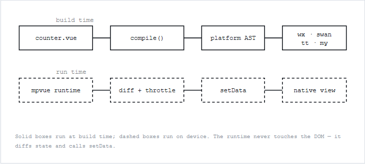
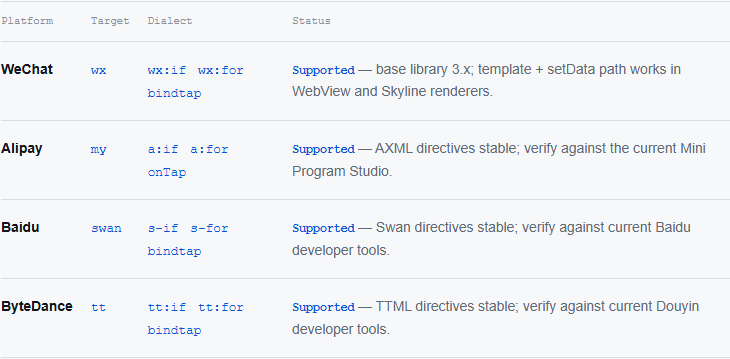

# Vue Mini Bridge

[](https://github.com/Archerkattri/vue-mini-bridge/actions/workflows/ci.yml)
[](https://www.npmjs.com/package/vue-mini-bridge)
[](https://doi.org/10.5281/zenodo.23330116)
[](LICENSE)

Vue Mini Bridge is a Vue 2 runtime and template compiler for mini-program projects. It continues the [mpvue](https://github.com/Meituan-Dianping/mpvue) codebase with an English-maintained source tree and updated build tooling.

<picture>
  <source media="(prefers-color-scheme: dark)" srcset="docs/playground-demo-dark.gif">
  
</picture>

The compiler runs at build time; the runtime updates native mini-program data
and views. This diagram shows where those two parts run:



The current adapters target four mini-program dialects. Their directives and
vendor-tool behavior differ, so verify an application in each platform's own
developer tools.



## Status

This project is derived from Vue 2.4.1-era mpvue and remains a Vue 2 project. It is not a Vue 3 compatibility layer. Vue 2 reached end of life on December 31, 2023; see the [Vue 2 end-of-life notice](https://v2.vuejs.org/eol/).

The source includes adapters for WeChat (`wx`), Baidu (`swan`), ByteDance (`tt`), and Alipay (`my`). Their behavior varies by platform and developer-tool version. The project’s automated tests cover the compiler and runtime adapters; validate your application in each target vendor’s current tools before release.

The latest GitHub source release is `v2.0.10`. That release did not publish npm packages; both package manifests are at `2.0.10`, while npm currently serves `2.0.9`. See the [changelog](CHANGELOG.md) for release details.

## Packages

- `vue-mini-bridge` provides the mini-program runtime.
- `vue-mini-bridge-template-compiler` compiles Vue templates into platform markup for use with a compatible loader.

The packages are built from this repository. Runtime changes belong under `src/`; generated package files are refreshed with the build commands below.

Install both packages in a mini-program application:

```sh
npm install vue-mini-bridge vue-mini-bridge-template-compiler
```

## Usage

In a mini-program environment that provides `App` and `Page`, create a Vue instance and register it with the runtime:

```js
const Vue = require('vue-mini-bridge')

const page = new Vue({
  data: { message: 'hello' }
})

Vue.createMP({
  mpType: 'page', // 'app' or 'component' are also supported
  init: () => page
})
```

The compiler package exposes `compile` and `compileToMPML`. A platform loader should call them during its build; it is not a replacement for the mini-program IDE or bundler configuration.

## Development

Use Node.js 22 or 24 and Yarn 1 through Corepack:

```sh
corepack yarn install --frozen-lockfile
npm run lint
npm run flow
npm run test:types
npm run test:mpvue
npm run test:weex
npm run test:ssr
```

`npm test` runs the full check sequence. Build the mini-program packages with `npm run build:mpvue`; build the Weex packages with `npm run build:weex`.

| Area | Status |
| ---- | ------ |
| Node.js runtime | 22, 24, and 26 tested (`engines: node >= 22`) |
| Mini-program runtime (`vue-mini-bridge`) | Build and MPVue integration checks retained; unit suite is removed from this branch |
| Template compiler (`vue-mini-bridge-template-compiler`) | Build and MPVue integration checks retained; unit suite is removed from this branch |
| Target adapters | WeChat (`wx`), Baidu (`swan`), Toutiao (`tt`), Alipay (`my`) |
| Aggregate `npm test` | Lint, Flow, type checks, SSR/Weex/MPVue integration checks; no unit suite |

For upstream issue and pull-request review, dependency decisions, and deferred migrations, see [MAINTENANCE.md](MAINTENANCE.md).

## Attribution

`npm run test:mpvue` runs the MPVue compiler/runtime integration checks. Other
focused checks include `npm run lint`, `npm run flow`, `npm run test:types`,
`npm run build:mpvue`, `npm run test:weex`, and `npm run test:ssr`.

Set `SOURCE_DATE_EPOCH` to pin the banner year for reproducible builds.

## Relationship to upstream

This repository continues [mpvue](https://github.com/Meituan-Dianping/mpvue)
by Meituan, itself a fork of [vuejs/vue@2.4.1](https://github.com/vuejs/vue).
The original MIT license and attribution are preserved in [`LICENSE`](LICENSE),
and the historical source is available as the `upstream` Git remote. Vue Mini
Bridge is not affiliated with Meituan, Vue, or any mini-program platform vendor.

## Citation

If you use Vue Mini Bridge in your work, please cite it. The easiest way
is the **Cite this repository** button in the GitHub sidebar, which
exports APA and BibTeX from [CITATION.cff](CITATION.cff). A ready-made
BibTeX entry for this release:

```bibtex
@misc{Attri2026VueMiniBridge,
  author = {Attri, Krishi},
  title = {vue-mini-bridge},
  year = {2026},
  version = {2.0.10},
  doi = {10.5281/zenodo.23330116},
  url = {https://github.com/Archerkattri/vue-mini-bridge}
}
```

## License

MIT. See [LICENSE](LICENSE).
